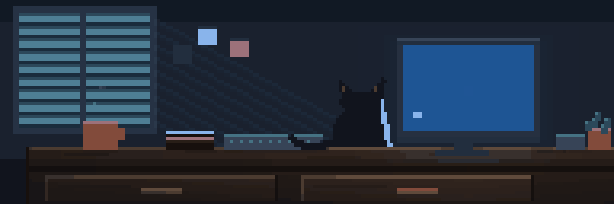
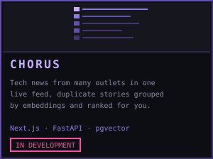
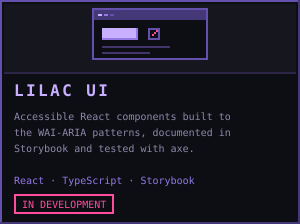
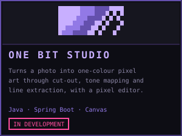
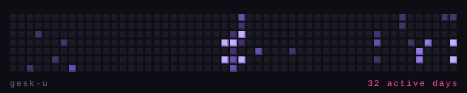

<div align="center">



# Anastasiia Tkach

**Full-stack developer · ICT engineering student at Metropolia · Helsinki**

<a href="https://anastasiia.dev">
  
</a>
<a href="https://www.linkedin.com/in/anastasiia-tkach-bb8377397/">
  
</a>
<a href="mailto:anastasiia.tkach.dev@gmail.com">
  
</a>
<a href="https://github.com/gesk-u">
  
</a>

</div>

---

## 01. whoami

```js
const anastasiia = {
  role:      "full-stack developer",
  studying:  "ICT engineering @ Metropolia, Helsinki",
  building:  [
    "CHORUS", 
    "LILAC UI", 
    "ONE BIT STUDIO"
    ],
  learning:  ["ML Zoomcamp", "Java", ""],
  languages: [
    "English", 
    "Russian", 
    "Ukrainian",
    "Finnish (B1.1)", 
    ],
  wants: "an internship where I ship real things with a real team"
};
```
I enjoy work that combines technical problem-solving, planning and teamwork, 
and I care about writing clean, readable code. 
My first degree was in chemistry. Lab work makes you slow down, write down what you
did, and check it twice. That habit turned out to transfer.
Now I’m looking for an internship where I can contribute to real 
roducts and grow both technically and professionally.

---

## 02. tech & tools

<table>
  <tr><td><b>Languages</b></td><td>    </td></tr>
  <tr><td><b>Frontend</b></td><td>  </td></tr>
  <tr><td><b>Backend</b></td><td>   </td></tr>
  <tr><td><b>Data</b></td><td>  </td></tr>
  <tr><td><b>Tooling</b></td><td>     </td></tr>
</table>

---

## 03. projects

<table>
  <tr>
    <td width="33%" valign="top">
      <a href="https://github.com/gesk-u/chorus">
        
      </a>
      <p align="center"><a href="https://github.com/gesk-u/chorus">code</a></p>
    </td>
    <td width="33%" valign="top">
      <a href="https://github.com/gesk-u/lilac-ui">
        
      </a>
      <p align="center"><a href="https://github.com/gesk-u/lilac-ui">code</a></p>
    </td>
    <td width="33%" valign="top">
      <a href="https://github.com/gesk-u/one-bit-studio">
        
      </a>
      <p align="center"><a href="https://github.com/gesk-u/one-bit-studio">code</a></p>
    </td>
  </tr>
</table>

<!-- EDIT: fix the three repo URLs to match your actual repo names.
     Add a demo link next to each "code" link once a project is deployed. -->

Earlier work worth a look:

- **Sanahaku** — finds a Finnish word spoken in YouTube videos and opens the video at
  that exact second, so you hear it in context. Built in a four-person Scrum team:
  Scrum Master in sprint one, then backend. `React · Express · MongoDB`
- **TeamGuesser** — aviation-themed multiplayer game where players guess the distance
  between airports, with real-time rooms over Socket.IO. `Python · Flask · MariaDB`

---

## 04. contributions

<div align="center">
  
</div>

---

## 06. beyond github

- First degree in chemistry and biology, before switching to software
- Native Ukrainian, working in English, learning Finnish from vlogs and real speech
- Strength training, board games, and baking pastries

---

## 07. let's make something useful

I'm looking for a software internship in Finland, starting 2027. If you're building
something and need someone who'll read the docs, ask the awkward question early and
leave the codebase tidier than she found it, get in touch.

<div align="center">

[anastasiia.dev](https://anastasiia.dev) · 
[LinkedIn](https://www.linkedin.com/in/anastasiia-tkach-bb8377397/) · 
[Email](mailto:anastasiia.tkach.dev@gmail.com)

<sub>The cat is Oona. She supervises.</sub>

</div>